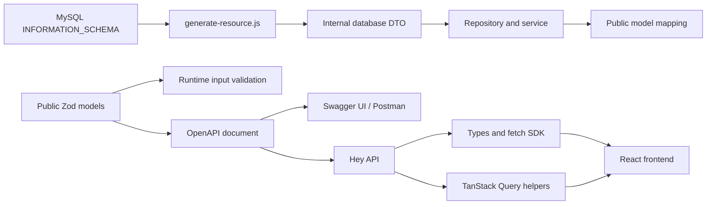

# Code generation, Swagger, and findep

The generator and OpenAPI export script were byte-for-byte identical in the two
repos when compared on October 25, 2026. The major missing piece here was
findep's frontend code-generation pipeline. This starter now includes that
pipeline with a Vite/React auth example and checks for generated-code drift.

## Two independent generation paths



The DTO generator does not generate API routes, public models, OpenAPI entries,
or frontend hooks. It reads SQL column metadata and produces internal row
interfaces. Swagger displays the contract; Hey API consumes it. Neither of
those tools introspects the database. Keeping these paths separate prevents
password hashes and other storage fields from becoming public API fields.

## Comparison

| Area | findep at inspection | Starter after this port |
| --- | --- | --- |
| Resource generator | DTO-only; DB introspection; automatic build | Same role, plus deterministic output, previewed contents, `--check`, stricter flags, mapping tests |
| Public contract | Zod models and OpenAPI export | Same approach, with required request bodies and stable operation IDs |
| Swagger | `/api/docs`, `/api/openapi.json` | Same endpoints |
| Hey API | Fetch SDK, JS enum-like objects, TanStack query helpers/hooks | Same plugins in `client/openapi-ts.config.ts` |
| Auth | Clerk token callback, local provider identity mapping | In-memory access-token callback and HTTP-only custom refresh cookie |
| Current-user endpoint | `/api/users/me` | Added `/api/users/me`; existing ID route retained |
| Frontend | Financial dashboard and feature-specific invalidation | Minimal account example; no financial domain or Clerk dependency |
| Runtime config | `VITE_API_BASE_URL` | Same variable, credentialed fetch, HTTPS development proxy |
| Codegen checks | Client build generates SDK | Builds generate SDK; a separate read-only check detects drift before build |
| Lint | Client has its own rules | Root no-casting policy on handwritten TS; only Hey API output exempt |
| DECIMAL results | mysql2 `decimalNumbers: true` | Default exact strings; generator corrected to match this pool |

The versions of the generator, SDK configuration, and generated client are
locked by `client/package-lock.json`. Vite uses a patched release rather than
copying findep's version unchanged. A targeted `js-yaml` override patches the
YAML parser pinned by the chosen Hey API version; reassess it when updating
Hey API. The override affects development/code-generation tooling.

## DTO generation

```sh
cd server
npm run generate:resource -- organization
npm run generate:resource -- organization --from-db --dry-run
npm run generate:resource -- organization --from-db
npm run generate:resource -- organization --from-db --check
```

`--dry-run` prints the target path and full proposed DTO; it does not write or
build. `--check` compares the generated content with the file and fails when it
is missing or stale, without writing or building. DB-backed check mode still
needs a database containing the expected migrations. It is not part of default
CI because that CI does not provision MySQL.

Generated DB headers no longer include timestamps, so unchanged schemas produce
unchanged files. `--from-db` retains its existing overwrite behavior; use a dry
run to inspect a proposed change. The first regeneration of an old
timestamp-header DTO will update its header. Unknown flags and missing flag
values now fail early. Non-identifier SQL column names become quoted TS
properties. Introspection closes its connection even when querying fails.

The starter's mysql2 pool uses `dateStrings: true` and default decimal parsing:
date/time columns map to strings, `DECIMAL` maps to string, `BIT` and binary
columns map to `Buffer`, `JSON` and unsupported types map to `unknown`.
`TINYINT` maps to number, not boolean. `BIGINT` currently maps to number because
that is the current pool behavior; projects needing exact integers outside
JavaScript's safe range must change driver options and generation together.
These interfaces describe expected rows; they do not validate runtime results.

## Public contract and generated client

Backend request/response schemas live in `server/src/models`; route metadata
lives in `server/src/openapi/document.ts`. Every operation needs a unique,
stable `operationId`, since names such as `getCurrentUser` and
`registerUserMutation` become frontend imports. Mark required request bodies
explicitly so generated calls cannot omit them.

From the root:

```sh
npm run api:generate
npm run api:check
```

The check runs the generator into a temporary directory, compares all files,
and removes the temporary output. It does not rewrite the committed SDK. Root
`npm run check` runs this before the frontend build, so regeneration during the
build cannot conceal stale committed files. CI installs both lockfiles and runs
the same root checks.

Configure base URL, credentials, and the bearer token callback once in
`client/src/api/client.ts`. The callback returns a bearer token only for bearer
security schemes; refresh cookies remain browser-managed. `credentials:
"include"` sends cookies where allowed. Custom-auth refresh/logout must not be
treated as Clerk-style bearer-token operations.

Example query:

```tsx
import { useQuery } from "@tanstack/react-query";
import { getCurrentUserOptions } from "./api/generated/@tanstack/react-query.gen";

const currentUser = useQuery({
  ...getCurrentUserOptions(),
  enabled: hasSession,
});
```

Generated mutation options can be extended with success callbacks to invalidate
relevant generated query keys. The starter clears and cancels cached queries
when changing sessions, preventing data from a previous account from appearing
under a new token. It disables mutation retries and uses explicit refresh
actions, avoiding automatic replay of rotating refresh tokens.

## What production history does not prove

The local comparison establishes implementation differences, not deployment
history, infrastructure settings, or production load behavior. This port keeps
the middleware → controller → service → repository architecture and the
custom-auth implementation. Production rate limits, CSRF/CORS policy, database
migration execution, observability, and hosting still need project-specific
choices. The starter tests exercise code generation and generated requests;
they are not a live MySQL end-to-end deployment test.

References: [Hey API configuration](https://heyapi.dev/docs/openapi/typescript/configuration),
[TypeScript output](https://heyapi.dev/docs/openapi/typescript/plugins/typescript),
[TanStack Query plugin](https://heyapi.dev/docs/openapi/typescript/plugins/tanstack-query),
[mysql2 parsing differences](https://sidorares.github.io/node-mysql2/docs/api-and-configurations).
