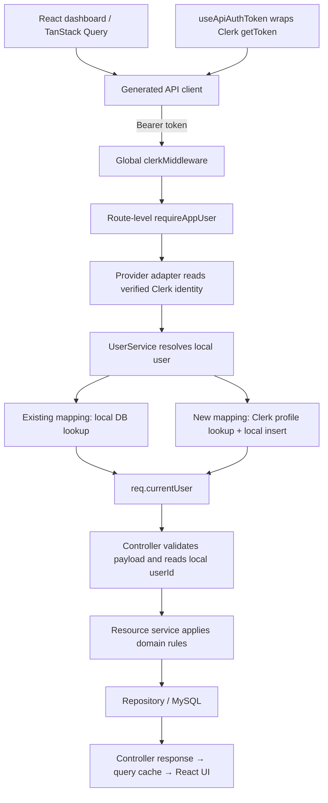

# Data flow and comparison with findep

This describes the checked-out source in `personal-express-ts-setup` and its
sibling `findep`, as inspected on October 25, 2026. Only this repository was
changed. See also [the auth walkthrough](current-auth-flow.md) and
[the API contract](openapi-zod-contract.md).

## The architecture to keep

The complete path is **route → middleware → controller → service → repository →
database**, with a mapper/public model on the response path. Middleware runs
before a controller where the route installs it; public registration and sign-in
do not require authentication.

| Layer | Responsibility | Example in this repo |
| --- | --- | --- |
| App | Parse HTTP input, install shared middleware, mount routes and errors | `src/app.ts` |
| Route | Choose handlers and middleware order | `src/routes/auth.route.ts` |
| Middleware | Authenticate identity and authorize access | `authenticateToken`, then `authorizeUserId` |
| Controller | Validate HTTP input, invoke a use case, choose response/cookies | `src/controllers/auth.controller.ts` |
| Service | Apply business rules and coordinate persistence | `UserService` |
| Repository | Own SQL and database write/read shapes | `UserRepository`, `RefreshTokenRepository` |
| DB helper | Execute parameterized SQL through the mysql2 pool | `src/config/db.ts` |
| DTO/projection | Describe internal database/query results | `UserDTO`, `AuthUserDTO`, `RevokedStatus` |
| Mapper/public model | Select and validate fields allowed in an API response | `toUserModel`, `UserSchema` |

DTOs describe storage. Public Zod models describe the API. A TypeScript type on
`req.body` alone does not validate a request; `validateWithZod` provides that
runtime check. Likewise, mysql2's `execute<UserDTO[]>` generic describes an
expected SQL result; it does not validate rows or check SQL against migrations.

## Protected read in this repository

```mermaid
sequenceDiagram
    participant Client
    participant Route
    participant Auth as Auth middleware
    participant Controller
    participant Service
    participant Repo as Repository / MySQL
    Client->>Route: GET /api/users/7 + Bearer token
    Route->>Auth: authenticateToken
    Auth->>Auth: Verify HS256 signature and validate sub
    Auth->>Auth: authorizeUserId compares identity with route ID
    Auth->>Controller: Validated req.user; access allowed
    Controller->>Service: getSingleUserById(7)
    Service->>Repo: queryByUserId(7)
    Repo-->>Service: UserDTO or null
    Service->>Service: toUserModel → UserSchema.parse
    Service-->>Controller: Public User or null
    Controller-->>Client: executeSafely sends response
```

The repository returns a row containing the password hash and timestamps. The
service's mapper selects only `{ userId, email }` and validates that object.
Those internal fields never become part of the public user response.

Authentication checks that `sub` is a canonical positive integer string within
JavaScript's safe integer range. Authorization applies the same check to the
route ID before comparing them. Inputs such as `7junk`, `7.5`, `07`, or an unsafe
integer fail instead of being partially parsed.

The starter now returns 404 when the requested user is missing, matching
OpenAPI. `GET /api/users/me` uses `authenticateToken` and derives the local ID
directly from `req.user.sub`, without a client-supplied ID.

## Registration, sign-in, refresh, and logout

| Request | Data flow | Result |
| --- | --- | --- |
| Register | Controller validates credentials → service validates again, checks email, hashes password → repository inserts user | 201 `{ success: true }` |
| Sign in | Controller validates → service queries credentials, verifies Argon2 hash, generates tokens, stores refresh hash | Controller sets refresh cookie and returns `{ accessToken }` |
| Refresh | Service validates cookie → verifies signature and claims → queries stored hash → checks expiration → atomically consumes token → issues and stores replacement | Controller replaces cookie and returns `{ accessToken }` |
| Logout | Service validates cookie → hashes valid token and revokes matching row → clears cookie | Controller returns `{ success: true }` |

Access tokens last 15 minutes; refresh tokens last 7 days and include a random
`jti`. The browser receives the raw refresh token in a secure, HTTP-only,
SameSite-strict cookie. MySQL stores its SHA-256 hash. Refresh reuse revokes all
active refresh tokens for that user; logout does not immediately invalidate an
already-issued access token.

Malformed/non-string refresh cookies are rejected before refresh verification.
Logout clears a malformed or absent cookie and succeeds without hashing it.
JWT secrets must be nonblank strings. Missing secrets remain configuration
errors rather than being reported as a user's invalid token.

There are two response/error mechanisms: controllers call `executeSafely` to
send successful results and forward rejected service calls; the final
`errorHandler` formats `AppError` instances and unexpected errors. Express 5
also forwards thrown errors/rejected async handlers, including controller input
validation that happens before `executeSafely`.

## How findep differs

`findep` uses the same backend layers. Clerk adds an identity-resolution path
before the resource controller:



For example, `POST /api/cash-flow-entries` runs `requireAppUser`, then
`createCashFlowEntry`. The controller validates `CreateCashFlowEntryInputSchema`
and calls `CashFlowEntryService.createEntryForUser(getCurrentUserId(req), body)`.
The service validates the amount/category, resolves the category's DB ID, and
calls `CashFlowEntryRepository.create`. Ownership comes from the authenticated
local user, independent of any submitted user ID.

The local mapping is keyed by `(authProvider, providerUserId)`. An existing user
requires a local DB lookup, with no explicit Clerk profile API call from the
adapter. A new user triggers `getProfile`, an insert, and a read; a duplicate-key
race falls back to querying the mapping again. The global Clerk middleware may
itself perform verification work; the profile-call distinction is specifically
about `ClerkAuthProviderAdapter.getProfile`.

On the frontend, `useDashboardData` starts several generated queries, enables
projection loading once prerequisite records exist, and assembles a dashboard
view. Mutation hooks invalidate dependent query keys so changes are refetched.
At the time of the initial comparison this repository had no frontend. It now
includes a Vite/React starter with generated SDK calls and TanStack helpers;
see [the code-generation workflow](codegen-and-findep-comparison.md).

| Concern | This repository | findep |
| --- | --- | --- |
| Session owner | Custom Argon2/JWT/refresh implementation | Clerk |
| Authenticated request context | Validated token claims in `req.user` | Local application user in `req.currentUser` |
| Local identity | JWT `sub` already holds local numeric ID | Provider identity must resolve to a local numeric ID |
| Ownership check | Compare token subject with requested user ID | Derive local user ID from context and scope queries to it |
| Before-controller work | Token validation and route ownership check | Clerk verification plus local-user lookup/bootstrap |
| Business data | User/session records | Financial goals, cash flow, net worth, projections |
| Public contract | Zod → OpenAPI | Zod → OpenAPI → generated client/query hooks |

## Assessment and boundaries to maintain

This repository is easier to follow because identity is already a local ID and
the application is smaller. That does not make findep's flow architecturally
wrong: the identity mapping connects a provider-owned account to app-owned
financial records, and its resource requests still follow the same layers.

There are useful improvements to preserve as separate, focused work:

1. **Keep HTTP at the controller boundary.** Here, `refreshAccessToken` and
   `logout` still accept Express `Request`/`Response` and clear cookies. A future
   change can pass a validated token into services and return a result that lets
   controllers clear cookies, including failure cases.
2. **Keep persistence out of token utilities.** `utils/jwt.ts` currently calls
   `RefreshTokenRepository` through `handleRefreshToken`. Moving that
   orchestration into the service would make token utilities easier to test.
3. **Keep provider details out of resource controllers.** findep already does
   this through its adapter and `req.currentUser`; there is no need to adopt a
   different business-layer architecture to use Clerk.
4. **Make bootstrap behavior explicit.** Any protected findep request can create
   the local mapping, and dashboard queries can initiate this concurrently.
   Race handling exists, but an explicit onboarding path could make that write
   easier to see if onboarding rules grow.
5. **Keep public response shapes distinct from rows.** This repo maps users;
   some findep financial services return internal projection types directly.
   Dedicated public models/mappers would make those boundaries more consistent.
6. **Treat runtime validation separately from cast removal.** The new policy
   prevents type overrides; it does not prove arbitrary SQL results or generic
   cache reads are valid. Those boundaries would need schemas if runtime checks
   are required. The current cache defaults to a no-op and is not used by these
   auth services.

The cast cleanup keeps the current layers and endpoint shapes. It does not
migrate authentication providers or change findep.

## Reading order

In this repo: `app.ts` → `routes/index.ts` → `routes/auth.route.ts` →
`middlewares/authenticateToken.middleware.ts` →
`middlewares/authorization.middleware.ts` → `controllers/auth.controller.ts` →
`services/auth.service.ts` → `repositories/*.ts` → `config/db.ts`.
Read `mappers/user.mapper.ts`, `models`, and `utils/executeSafely.ts` for the
response path.

In findep: `client/src/features/dashboard/hooks/useDashboardData.ts` →
`client/src/features/dashboard/hooks/useApiAuthToken.ts` → generated client →
`server/src/app.ts` → `middlewares/appAuth.middleware.ts` → `auth/*.ts` and
`services/auth.service.ts` → resource controller/service/repository.
